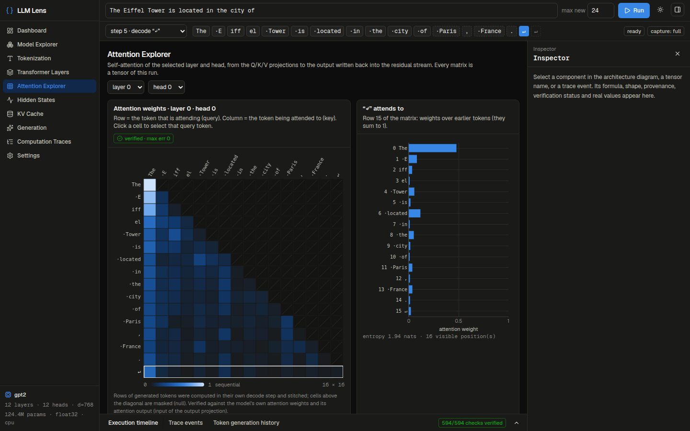
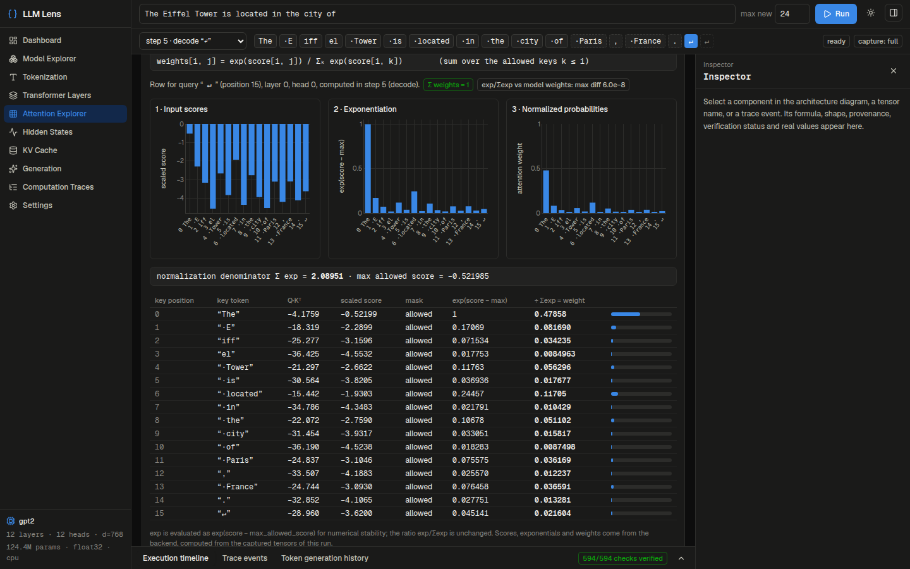
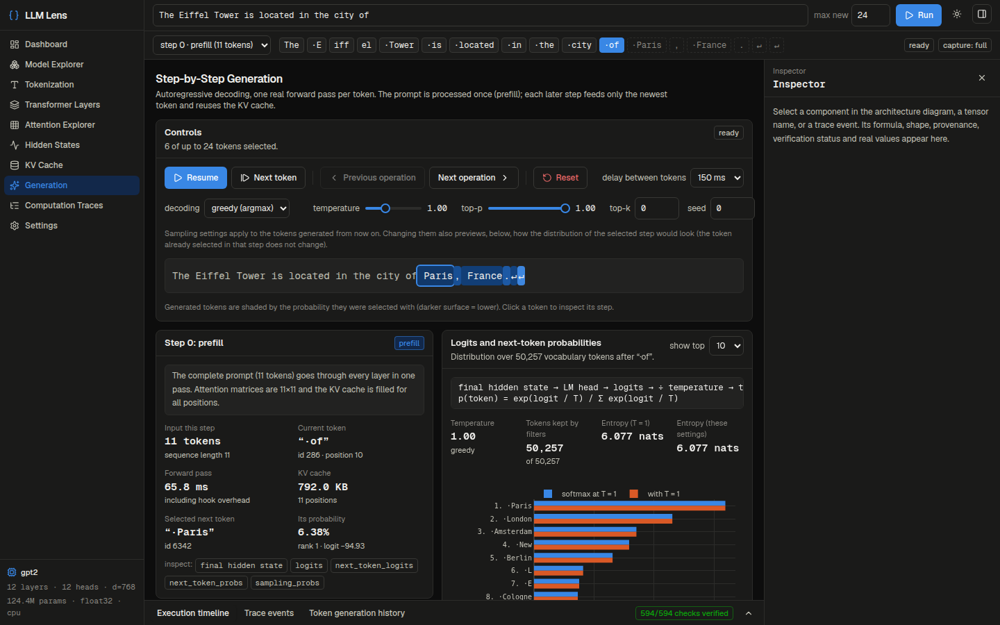
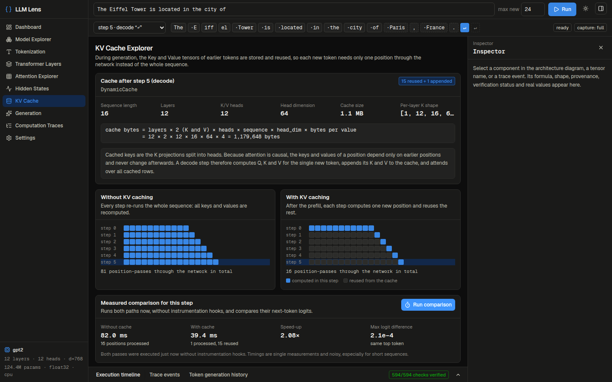
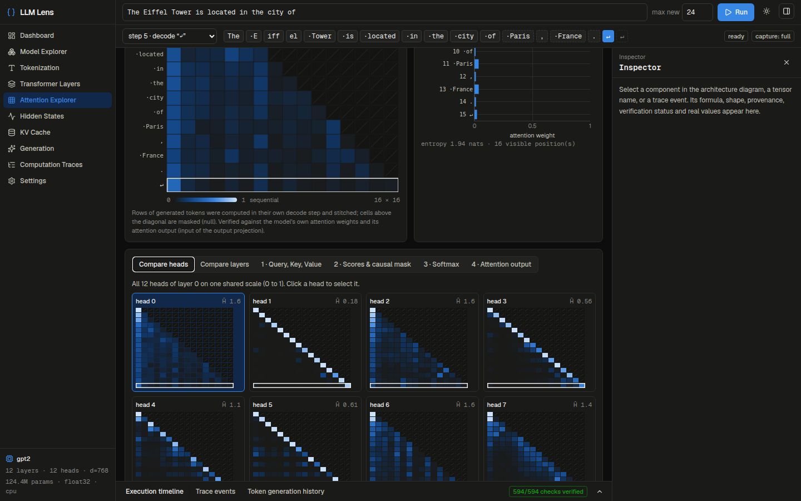
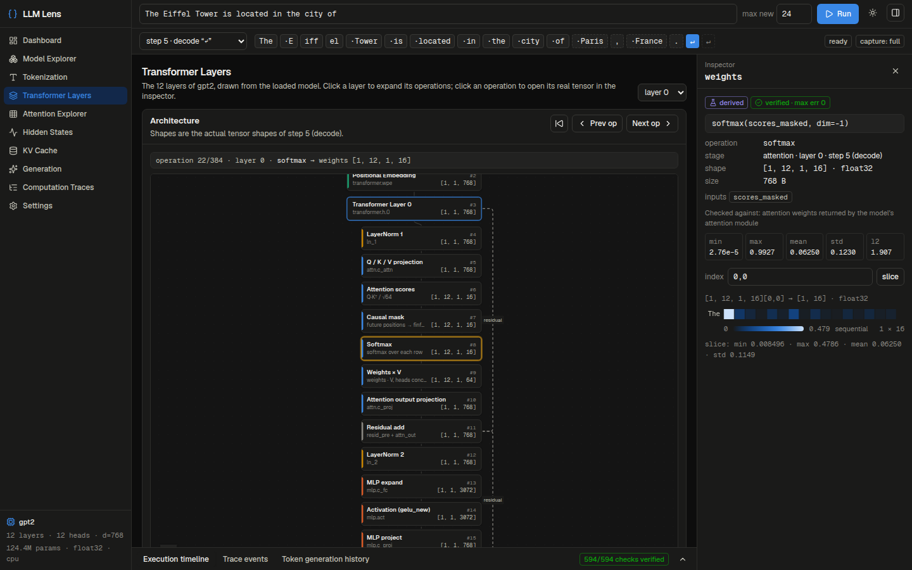
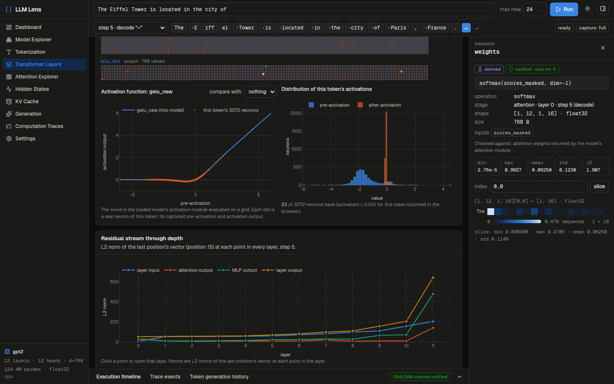
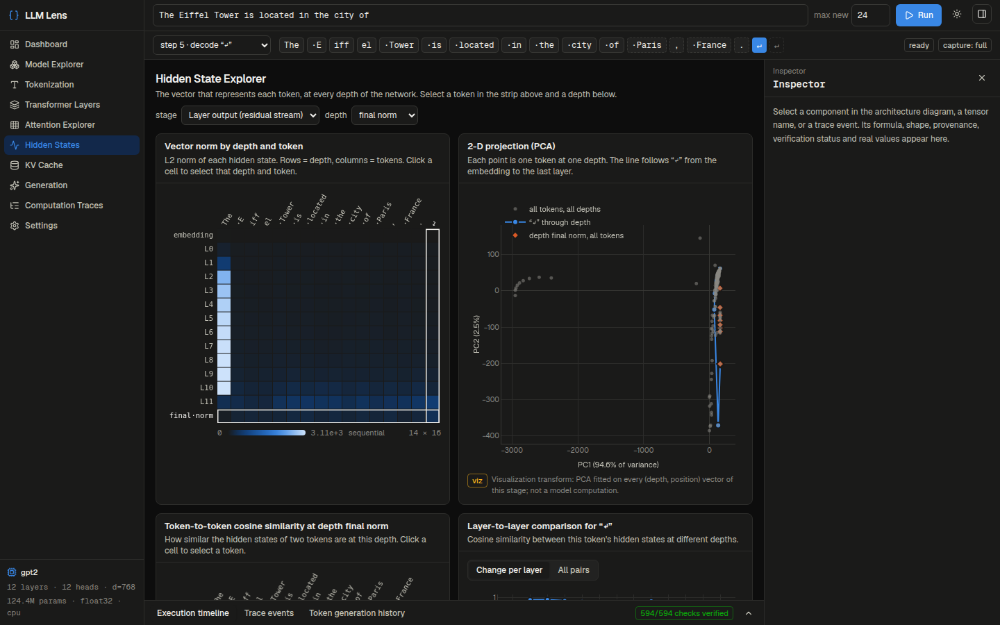
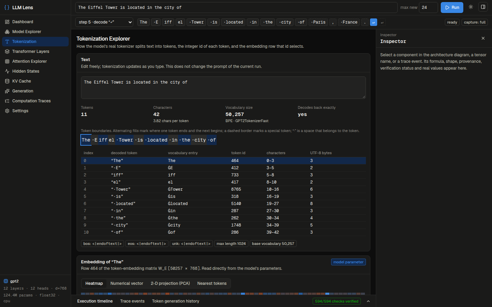
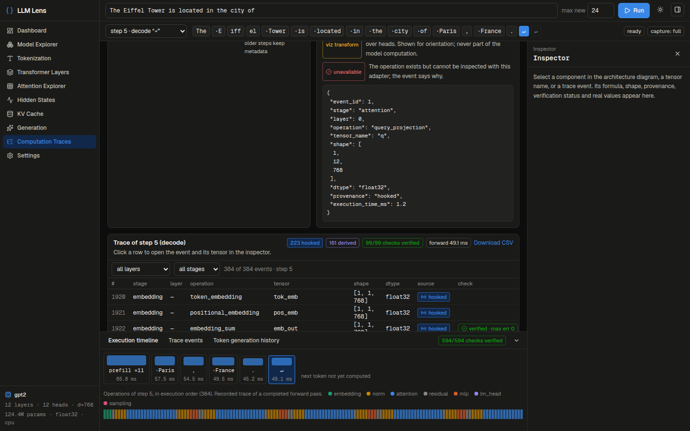

# LLM Lens

Interactive Transformer visualization studio. Enter text, run a real causal language model, and inspect
the computations inside every layer: tokens, embeddings, normalization, Q/K/V, attention scores, causal
mask, softmax, residual additions, the MLP, logits, sampling and the KV cache.

Nothing is simulated. Values are captured from the model with PyTorch forward hooks. Operations that have
no module boundary (for example `Q·Kᵀ` or the softmax inside attention) are recomputed from the captured
tensors with the model's own parameters and then **checked against what the model itself produced**; the
UI shows the result of that check next to every such tensor.

Supported architectures: **GPT-2**, **Qwen2 / Qwen2.5**, **Llama-compatible** decoders (Llama, SmolLM2,
TinyLlama, …). Other architectures are rejected with a clear message until an adapter is added.

## Screenshots

All screenshots show GPT-2 running the prompt "The Eiffel Tower is located in the city of".

**Transformer Layers.** The architecture diagram is drawn from the loaded model. Clicking an operation opens its tensor in the inspector with its formula, shape, provenance and verification result.


**Attention Explorer.** Attention weights for one layer and head, and what the selected token attends to.



**Softmax, step by step.** Scores, exponentials, the normalization denominator and the resulting weights for one attention row.



**Generation.** Logits and next-token probabilities for each step, with sampling controls.



**KV Cache.** What each step computes with and without the cache, plus a measured comparison.



<details>
<summary>More screenshots</summary>

**Comparing attention heads**



**Normalization, with every intermediate value**



**Feed-forward network and activation function**



**Hidden states**



**Tokenization**



**Computation traces**



</details>

## Quick start

Requirements: Python 3.11+, Node 20+. A GPU is optional.

```bash
# backend  (http://localhost:8000, API docs at /docs)
cd backend
python3 -m venv .venv && .venv/bin/pip install -r requirements.txt
.venv/bin/uvicorn app.main:app --port 8000

# frontend (http://localhost:3000)
cd frontend
npm install
npm run dev            # or: npm run build && npm start
```

Or `docker compose up --build` (CPU images).

Then open http://localhost:3000:

1. **Model Explorer**: load a model from `models/` or any local directory, or enter a Hugging Face id.
   A model that is not available locally is only downloaded after you confirm the size prompt.
2. Type a prompt in the top bar and press **Run**. This runs the traced prefill pass.
3. Explore: **Transformer Layers** (architecture diagram, normalization, residuals, MLP),
   **Attention Explorer**, **Hidden States**, **Generation** (step by step, sampling controls),
   **KV Cache**, **Computation Traces**.

To fetch the small models used during development:

```bash
cd backend && .venv/bin/python -c "
from huggingface_hub import snapshot_download
for repo, name in [('openai-community/gpt2','gpt2'), ('HuggingFaceTB/SmolLM2-135M','SmolLM2-135M'), ('Qwen/Qwen2.5-0.5B-Instruct','Qwen2.5-0.5B-Instruct')]:
    snapshot_download(repo, local_dir=f'../models/{name}', allow_patterns=['*.json','*.safetensors','*.txt','*.model'])"
```

## Tests

```bash
cd backend && .venv/bin/python -m pytest          # 66 tests
cd frontend && npx tsc --noEmit && npx eslint . && npm run build
```

The backend suite builds tiny randomly initialised GPT-2, Llama and Qwen2 models from configs (no
download) and compares every captured and re-derived tensor with plain PyTorch. `tests/test_real_models.py`
repeats the key checks on the downloaded weights and is skipped when they are absent.

## Documentation

- [docs/architecture.md](docs/architecture.md): system design, adapters, memory model
- [docs/computation-trace.md](docs/computation-trace.md): trace schema, tensor names, provenance and verification
- [docs/api.md](docs/api.md): REST and SSE endpoints
- [docs/development.md](docs/development.md): setup, adding an adapter, roadmap, known limitations
